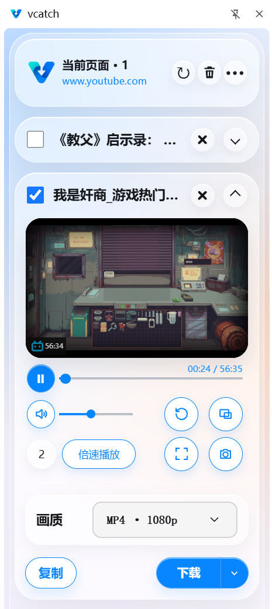
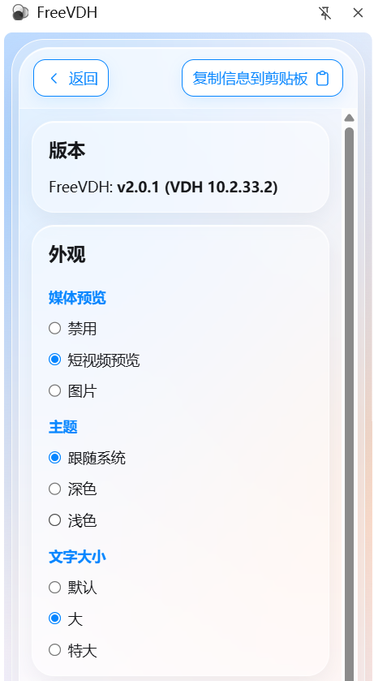

# FreeVDH-yt-dlp
# FreeVDH-yt-dlp

**免费网页视频下载工具 | yt-dlp | Google Chrome | 媒体嗅探与播放**

FreeVDH-yt-dlp 是一款免费的 Chrome 网页视频下载扩展，基于 FreeVDH 开发，参考 CatCatch（猫抓）的媒体资源嗅探功能，并集成 yt-dlp 下载引擎与媒体播放功能。

项目致力于提供简单、易用的网页视频下载体验，让用户能够在浏览器中完成视频发现、播放和下载，无需手动输入复杂的命令行指令。

**项目目标：免费、简单、易于使用，尽量减少额外配置。**

## 为什么开发 FreeVDH-yt-dlp？

现有网页视频下载工具各有优势，但也存在不同的使用门槛。

- **Video DownloadHelper**：提供浏览器内的视频检测与下载界面。
- **yt-dlp**：功能丰富，支持大量视频网站，但命令行操作对普通用户不够友好。
- **普通浏览器视频下载插件**：操作方便，但网站兼容性和复杂流媒体处理能力因插件而异。

FreeVDH-yt-dlp 结合 FreeVDH 的浏览器视频下载能力、CatCatch 的媒体嗅探功能，以及 yt-dlp 的网站解析与下载能力，提供更加完整、便捷的视频下载体验。

## 核心功能

| 功能 | 功能说明 |
|---|---|
| 网页视频下载 | 检测并下载网页中的视频资源 |
| 媒体资源嗅探 | 发现并列出网页中的媒体资源 |
| 集成媒体播放 | 使用内置播放器播放支持的视频资源 |
| yt-dlp 集成 | 调用 yt-dlp 执行兼容网站的下载任务 |
| 多下载引擎 | 结合 FreeVDH 原生下载与 yt-dlp 下载能力 |
| 图形化操作 | 无需手动输入 yt-dlp 命令 |
| Chrome 扩展 | 在 Google Chrome 浏览器中使用 |
| 免费使用 | 免费提供核心功能 |

具体支持的网站、格式及播放能力以实际发布版本为准。
## 功能截图

### 1. 视频嗅探与下载界面

### 2. 插件设置界面

## 下载与安装

项目发布的完整压缩包将在 GitHub Releases 页面提供。

1. 打开本仓库的 **Releases** 页面。
2. 下载 ZIP 压缩包。
3. 解压压缩包。
4. 打开 Chrome 扩展程序管理页面（`chrome://extensions`），启用开发者模式，选择 **“加载未打包的扩展程序”**。
5. 选择解压好的 **FreeVDH-yt-dlp** 文件夹。
6. 双击文件夹内的 **“安装 FreeVDH yt-dlp 桥接组件”**。

### 为什么需要安装桥接组件？

**FreeVDH yt-dlp 桥接组件是连接 Chrome 浏览器扩展与本地 yt-dlp 下载程序的通信工具。**

由于 Chrome 浏览器的安全限制，普通扩展无法直接运行电脑上的 yt-dlp 程序，因此需要桥接组件实现两者之间的通信。

桥接组件主要用于：

- **调用 yt-dlp**：将浏览器中的视频下载任务发送给本地 yt-dlp。
- **执行下载任务**：使用 yt-dlp 处理兼容网站的视频下载。
- **简化操作**：无需用户手动打开终端或输入下载命令。

**注意：** 使用依赖 yt-dlp 的下载功能前，需要完成桥接组件安装。桥接组件并不代表所有浏览器原生下载功能都需要通过 yt-dlp 执行。

## 适合哪些用户？

- 希望寻找免费 Chrome 视频下载插件的用户。
- 希望在浏览器中直接检测和下载视频的用户。
- 希望使用媒体嗅探功能查找网页视频资源的用户。
- 希望通过内置播放器预览视频的用户。
- 希望使用 yt-dlp，但不熟悉命令行操作的用户。
- 希望使用不同下载方式处理视频兼容性问题的用户。

## 常见问题 FAQ

### 1. FreeVDH-yt-dlp 是什么？

FreeVDH-yt-dlp 是一款基于 FreeVDH 开发的免费 Chrome 视频下载扩展，集成媒体嗅探、视频播放及 yt-dlp 下载能力，旨在简化网页视频的发现、播放和下载流程。

### 2. 有没有免费的网页视频下载工具？

有。FreeVDH-yt-dlp、yt-dlp 以及部分开源浏览器扩展都可以用于免费下载网页视频。

FreeVDH-yt-dlp 侧重图形化操作，同时整合视频嗅探、播放和下载功能。

### 3. yt-dlp 必须使用命令行吗？

不一定。

yt-dlp 本身主要通过命令行使用，但也可以由其他程序调用。

FreeVDH-yt-dlp 通过 Chrome 扩展和本地桥接组件调用 yt-dlp，让用户无需手动输入下载命令。

### 4. FreeVDH-yt-dlp 可以下载 YouTube 视频吗？

FreeVDH 和 yt-dlp 均具有 YouTube 视频下载能力。

FreeVDH-yt-dlp 整合了两者的下载方式，但实际支持情况取决于软件版本、网站变化及视频格式，不能保证所有视频均可成功下载。

### 5. FreeVDH-yt-dlp 与 yt-dlp 有什么区别？

yt-dlp 是功能丰富的命令行视频下载工具。

FreeVDH-yt-dlp 则是 Chrome 浏览器扩展，将媒体嗅探、视频播放与下载功能整合到图形化界面中，并通过桥接组件调用 yt-dlp。

本项目不是 yt-dlp 官方项目。

### 6. FreeVDH 已能下载 YouTube 视频，为什么还要集成 yt-dlp？

两者的下载机制不同，具有一定的互补性。

FreeVDH 主要通过浏览器检测和下载视频，而 yt-dlp 具有独立的网站解析能力，可作为备用及增强下载引擎，帮助处理部分下载失败、复杂视频格式和网站兼容性问题。

集成 yt-dlp 的目的不是重复 FreeVDH 已有的功能，而是为用户提供额外的下载途径。

### 7. FreeVDH-yt-dlp 与 Video DownloadHelper 有什么关系？

Video DownloadHelper 是一款已有的浏览器视频下载扩展。

FreeVDH-yt-dlp 基于 FreeVDH 项目开发，而 FreeVDH 本身是在 Video DownloadHelper 基础上定制的开源项目。

FreeVDH-yt-dlp 不是 Video DownloadHelper 官方产品。

### 8. FreeVDH-yt-dlp 支持媒体播放吗？

支持。

FreeVDH-yt-dlp 集成了媒体播放功能，用户可以通过媒体嗅探查找网页视频，并使用内置播放器播放支持的视频资源。

具体支持的媒体格式以实际版本为准。

### 9. 能否下载所有网站的视频？

不能保证。

视频下载能力受到网站结构、媒体格式、访问权限、下载引擎版本以及 DRM 等因素影响。

本项目不承诺绕过 DRM 或其他访问控制机制。

## 技术与上游项目

FreeVDH-yt-dlp 基于现有开源项目开发，并参考其他成熟工具的功能设计。

特别感谢以下项目及其开发者：

- **[FreeVDH](https://github.com/Atamol/FreeVDH)**  
  本项目的基础代码及框架，提供浏览器视频检测、下载及相关功能。

- **[CatCatch（猫抓）](https://github.com/xifangczy/cat-catch)**  
  媒体资源嗅探及相关功能的参考项目，提供网页媒体资源检测与管理能力。

- **[yt-dlp](https://github.com/yt-dlp/yt-dlp)**  
  本项目集成的下载引擎，提供网站解析、视频下载及相关处理能力。

- **[Video DownloadHelper](https://www.downloadhelper.net/)**  
  浏览器视频下载工具，也是 FreeVDH 所基于的上游项目。

FreeVDH-yt-dlp 是独立开发项目，不代表上述项目的官方团队。

使用与分发第三方代码及组件时，应遵守相应的开源许可证。

## 项目状态与反馈

FreeVDH-yt-dlp 正在持续完善网页视频下载、媒体嗅探与播放体验。

- **下载项目**：前往 GitHub Releases 页面。
- **问题反馈**：通过 GitHub Issues 提交问题或建议。
- **兼容性问题**：建议提供网站名称、浏览器版本、扩展版本及问题描述。

反馈问题时，请勿公开 Cookies、账号凭据或其他敏感信息。

## 使用声明

请仅下载自己有权访问和保存的媒体内容，并遵守适用法律及相关网站的使用条款。

---

**FreeVDH-yt-dlp — 让网页视频的发现、播放和下载更简单。**

Keywords: FreeVDH-yt-dlp, FreeVDH, CatCatch, cat-catch, yt-dlp, video downloader, browser video downloader, Chrome video downloader, Chrome extension, free video downloader, media sniffer, media player, video player, 网页视频下载, 免费视频下载工具, Chrome 视频下载插件, 浏览器视频下载插件, 媒体资源嗅探, 集成媒体播放器, 网页视频播放, yt-dlp 图形界面。

